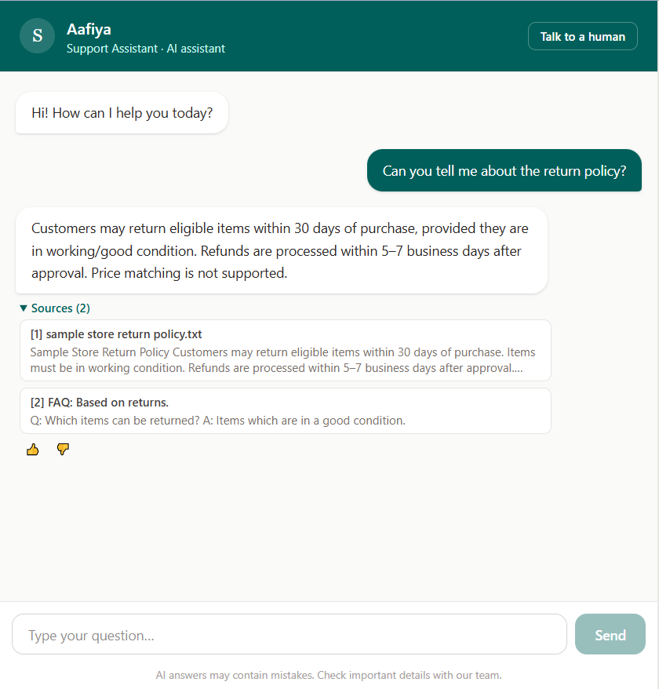
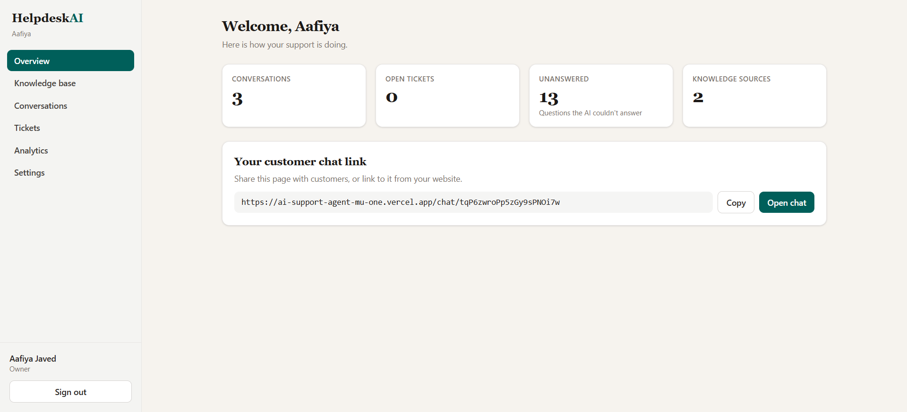
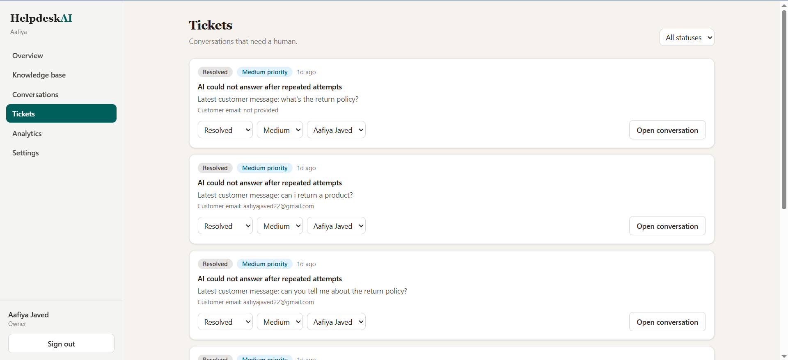
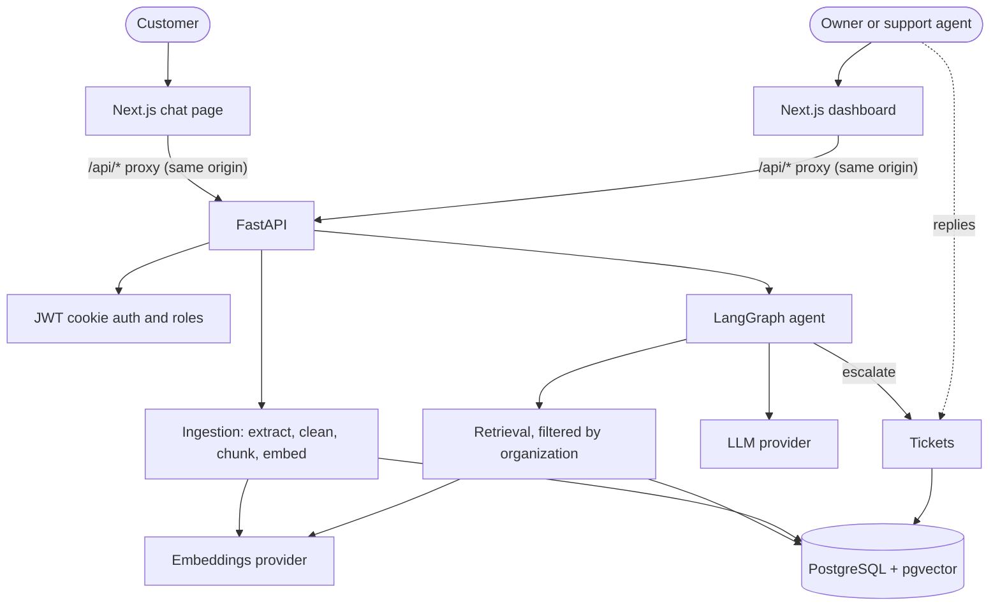

# Helpdesk AI: an AI customer support agent for businesses

A multi-tenant SaaS where a business uploads its own knowledge (PDF, DOCX, TXT, FAQs) and gets a customer-facing chat agent that:

- answers **only from that knowledge** (RAG), with source citations,
- says "I don't know" instead of inventing policies,
- hands difficult conversations to a human through a ticket system.


**Live demo:** https://ai-support-agent-mu-one.vercel.app

> The backend runs on a free Render instance, so the first request after inactivity can take up to a minute. The demo uses a free-tier LLM and sample data only, so please don't enter personal information.


| Customer chat | Dashboard | Tickets |
|---|---|---|
|  |  |  |


---

## Table of contents
1. [Features](#features)
2. [Architecture](#architecture)
3. [Tech stack](#tech-stack)
4. [Project structure](#project-structure)
5. [Quick start](#quick-start)
6. [Environment variables](#environment-variables)
7. [How RAG works](#how-rag-works)
8. [The LangGraph agent](#the-langgraph-agent)
9. [API overview](#api-overview)
10. [Testing and evaluation](#testing-and-evaluation)
11. [Deployment](#deployment)
12. [Security](#security)
13. [Troubleshooting](#troubleshooting)
14. [Limitations](#limitations)
15. [Roadmap](#roadmap)

---

## Features

**For businesses (dashboard)**
- Register a workspace, log in and out (JWT in an HTTP-only cookie)
- Roles: `owner` (full access) and `agent` (conversations and tickets only)
- Knowledge base: upload PDF, DOCX, TXT or write FAQ sets; live processing status; delete documents
- Conversations: read every chat, see which sources the AI used, reply as a human
- Tickets: assign, set status and priority, jump to the conversation, AI-written summary
- Analytics: conversations, messages, resolved, escalated, unanswered questions, feedback, 14-day trend
- Settings: business name, assistant name, greeting, support email, team members

**For customers (public chat page)**
- No account needed, conversation history kept in the browser session
- Answers with expandable sources
- 👍 / 👎 feedback on each answer
- "Talk to a human" button; optional email capture after escalation
- Human replies appear in the same chat

**AI behaviour**
- Retrieval-augmented answers grounded in the business's own documents
- Honest "not in the knowledge base" replies
- Automatic escalation on a request for a human, a complaint, or two consecutive misses
- Provider failures (rate limits, timeouts) are reported as service errors and are never counted as missing knowledge
- Prompt-injection guardrails, rate limits and per-organization daily quotas

---

## Architecture



Key design decisions:
- **Modular monolith**: one backend, one database, one frontend. No microservices, no separate vector database.
- **The browser never talks to the database or AI providers.** The Next.js server proxies `/api/*` to FastAPI, so auth cookies stay first-party and API keys stay on the server.
- **Tenant isolation**: every tenant-owned table carries `organization_id`, and every query filters by it.
- **Provider wrappers**: LLM and embeddings sit behind small interfaces (`services/providers/`). Switch providers with environment variables.
- **The graph code, not the model, creates tickets.** The LLM has no tools with side effects.

---

## Tech stack

| Layer | Technology |
|---|---|
| Frontend | Next.js (App Router), React, TypeScript, Tailwind CSS |
| Backend | Python 3.11+, FastAPI, SQLAlchemy 2, Alembic, Pydantic |
| Database | PostgreSQL with pgvector (Neon), HNSW cosine index |
| AI orchestration | LangGraph |
| LLM | Gemini, OpenRouter (any OpenAI-compatible model) or Anthropic Claude |
| Embeddings | Gemini (`gemini-embedding-001`, 768 dims) or OpenAI (`text-embedding-3-small`, 768 dims) |
| Documents | PyMuPDF (PDF), python-docx (DOCX), plain text |
| Auth | PyJWT, argon2 password hashing, HTTP-only cookies |
| Deployment | Vercel (frontend), Render (backend, Docker), Neon (database) |

---

## Project structure

```
ai-support-agent/
├── docker-compose.yml          # local Postgres + API
├── backend/
│   ├── app/
│   │   ├── main.py             # app, CORS, CSRF origin check, health endpoints
│   │   ├── schemas.py          # Pydantic request/response models
│   │   ├── core/               # config, security (JWT, hashing), rate limiting
│   │   ├── db/                 # engine/session and SQLAlchemy models
│   │   ├── api/
│   │   │   ├── deps.py         # current user, owner check, org lookup by public key
│   │   │   └── routes/         # auth, organization, documents, public_chat,
│   │   │                       # conversations, tickets, analytics
│   │   ├── services/
│   │   │   ├── ingestion/      # extractors, cleaner, chunker, pipeline
│   │   │   ├── providers/      # llm.py, embeddings.py
│   │   │   ├── retrieval.py    # pgvector similarity search
│   │   │   ├── chat.py         # persistence around the agent
│   │   │   └── tickets.py      # escalation and ticket status
│   │   └── agent/              # state, nodes, graph, prompts
│   ├── alembic/                # migrations
│   ├── tests/                  # unit tests
│   ├── evals/                  # RAG quality check
│   ├── Dockerfile
│   └── .env.example
└── frontend/
    ├── next.config.ts          # /api proxy rewrite
    └── src/
        ├── app/                # landing, auth, dashboard/*, chat/[orgKey]
        ├── components/         # ui kit, auth context
        └── lib/                # api client, hooks, types
```

---

## Quick start

**Requirements:** Python 3.11+, Node 20+, a [Neon](https://neon.tech) project (free), and an LLM key. A free [Gemini key](https://aistudio.google.com) or an [OpenRouter](https://openrouter.ai) key is enough to start.

### 1. Backend
```bash
cd backend
python -m venv .venv
# Windows PowerShell:  .venv\Scripts\Activate.ps1
# Windows cmd:         .venv\Scripts\activate.bat
# macOS/Linux:         source .venv/bin/activate
pip install -r requirements.txt
cp .env.example .env        # Windows cmd: copy .env.example .env
```
Edit `.env` (see [Environment variables](#environment-variables)), then:
```bash
alembic upgrade head        # enables pgvector and creates all tables (silent on success)
uvicorn app.main:app --reload
```
Check: `http://127.0.0.1:8000/health` → `{"status":"ok"}` and `/health/db` shows `connected` with a pgvector version. Interactive API docs are at `/docs`.

### 2. Frontend
The frontend source is in `frontend/src`. It needs a standard Next.js base project (`package.json`, Tailwind, TypeScript):
```bash
cd frontend
npm install
npm run dev
```
If you start from an empty folder, create the base with `npx create-next-app@latest` (TypeScript, ESLint, Tailwind, `src/` directory, App Router), then copy this repo's `src/` and `next.config.ts` over it.

Check: `http://localhost:3000` shows the landing page, and `http://localhost:3000/api/health` returns `{"status":"ok"}` (this proves the proxy works).

### 3. Try it
1. Register a workspace.
2. **Knowledge base → Add FAQ**: for example "What is your refund policy?" / "Refunds are accepted within 30 days with a receipt." Wait for the status to turn **Ready**.
3. **Overview → Open chat** and ask "Can I get a refund?" You should get a grounded answer with expandable sources.
4. Ask something unrelated. You should get an honest "I couldn't find that" reply.
5. Click **Talk to a human**, then reply from **Tickets → Open conversation**. The reply appears in the customer chat within a few seconds.

### Docker (backend and database)
```bash
docker compose up --build
```
Reads `backend/.env` for keys and uses its own local Postgres.

---

## Environment variables

`backend/.env` (never commit this file):

| Variable | Required | Description |
|---|---|---|
| `APP_ENV` | no | `development` (default), `production` or `test` |
| `FRONTEND_ORIGIN` | no | Origin of the frontend, used for CORS and the CSRF check. Default `http://localhost:3000` |
| `DATABASE_URL` | yes | Neon connection string (`postgresql://...?sslmode=require`) |
| `JWT_SECRET` | yes | At least 32 random characters: `python -c "import secrets; print(secrets.token_urlsafe(48))"` |
| `COOKIE_SECURE` | prod | Must be `true` in production |
| `COOKIE_SAMESITE` | no | `lax` (default) |
| `LLM_PROVIDER` | no | `gemini` (default), `openrouter` or `anthropic` |
| `EMBEDDING_PROVIDER` | no | `gemini` (default) or `openai` |
| `EMBEDDING_DIM` | no | `768`. Fixed in the database schema. Changing it needs a new migration and re-embedding |
| `GEMINI_API_KEY` | if used | LLM and/or embeddings |
| `OPENROUTER_API_KEY`, `OPENROUTER_LLM_MODEL` | if used | OpenRouter key and exact model ID |
| `ANTHROPIC_API_KEY` | if used | Claude |
| `OPENAI_API_KEY` | if used | OpenAI embeddings |

The app refuses to start if a selected provider has no key.

Tuning knobs live in `app/core/config.py` and can be overridden in `.env`:

| Setting | Default | Purpose |
|---|---|---|
| `CHUNK_SIZE` / `CHUNK_OVERLAP` | 800 / 100 | Characters per chunk and overlap between chunks |
| `RETRIEVAL_TOP_K` | 5 | Chunks retrieved per question |
| `RELEVANCE_THRESHOLD` | 0.35 | Minimum cosine similarity. Lower it if the bot says "not found" too often, raise it if it answers off-topic |
| `LLM_MAX_OUTPUT_TOKENS` | 600 | Raise for reasoning models, which can use the budget on hidden thinking |
| `MAX_UPLOAD_MB`, `MAX_PDF_PAGES` | 10, 300 | Upload limits |
| `MAX_MESSAGE_CHARS`, `MAX_HISTORY_MESSAGES` | 1000, 10 | Chat input and context limits |
| `CHAT_RATE_LIMIT_PER_MINUTE` | 20 | Per-IP limit on the public chat endpoint |
| `ORG_DAILY_MESSAGE_LIMIT` | 500 | Customer messages per organization per 24 hours |

`frontend/.env`: `BACKEND_URL` (server-side only, default `http://127.0.0.1:8000`). Never put secrets in `NEXT_PUBLIC_*` variables.

---

## How RAG works

**RAG** (retrieval-augmented generation) means finding the relevant company text first and instructing the model to answer only from it, instead of trusting its general memory.

### Indexing (once per document, in the background)
1. **Upload**: validated by extension, file signature (magic bytes), size, PDF page count and unzipped DOCX size.
2. **Extract**: PyMuPDF keeps page numbers, python-docx reads paragraphs and tables, TXT is decoded directly.
3. **Clean**: re-join hyphenated words, strip bare page numbers, remove headers and footers repeated across pages.
4. **Chunk**: paragraph-aware chunks of about 800 characters with 100 overlap. FAQs become one chunk per Q&A pair.
5. **Embed**: batched calls to the embeddings provider (768-dimension vectors).
6. **Store**: chunk text, page number, vector and `organization_id` go into `document_chunks`, with an HNSW cosine index. The document's status moves from `processing` to `ready` or `failed`.

### Answering (every customer message)
1. Rewrite follow-up questions into standalone search queries.
2. Embed the query and run a **top-k cosine search filtered by organization**.
3. Drop chunks below the similarity threshold. If nothing is left, don't call the model for an answer.
4. Send the surviving chunks, wrapped in `<source>` blocks and labelled as untrusted reference text, to the LLM with strict rules: answer only from sources, cite them as `[n]`, reply `NO_ANSWER` if the sources don't cover it.
5. Show the answer without the `[n]` markers and attach the cited sources. Save both with the message.

---

## The LangGraph agent

```
guardrails ─ blocked ─────────────────────────────────────────► finalize
    │
  intent ─┬─ human_request / complaint ─► escalate ───────────► finalize
          ├─ smalltalk ─► smalltalk ──────────────────────────► finalize
          ├─ out_of_scope ─► out_of_scope ────────────────────► finalize
          └─ knowledge_question
                │
             rewrite → retrieve → relevance
                                     ├─ relevant ─► generate ─┬─ answered ───────► finalize
                                     │                        ├─ provider error ─► service_error ─► finalize
                                     │                        └─ NO_ANSWER ──┐
                                     └─ nothing relevant ─────────────────────┤
                                                                              ▼
                              first miss ─► no_answer ─► finalize
                              second consecutive miss ─► escalate ─► finalize
```

| Node | Purpose |
|---|---|
| `guardrails` | Blocks common prompt-injection phrases. Plain code, no model call |
| `intent` | Regex catches "talk to a human". Otherwise a small LLM call labels the message. Output is whitelisted |
| `rewrite` | Makes follow-ups searchable |
| `retrieve`, `relevance` | Org-scoped vector search and similarity threshold |
| `generate` | Grounded answer with citations |
| `no_answer` | Honest "not in the knowledge base" reply |
| `service_error` | Provider failed: apologise, don't flag a knowledge gap, don't escalate |
| `escalate` | Marks the conversation for a human. `services/tickets.py` creates the ticket and AI summary |
| `finalize` | Normalizes the result shape |

When a conversation is escalated, the AI stops replying and the conversation belongs to the human agents.

---

## API overview

Full interactive documentation is served at `/docs` when the backend is running.

| Area | Endpoints |
|---|---|
| Health | `GET /health`, `GET /health/db` |
| Auth | `POST /auth/register`, `POST /auth/login`, `POST /auth/logout`, `GET /auth/me` |
| Organization | `GET/PATCH /organization`, `GET/POST /team` |
| Documents | `POST /documents` (upload), `POST /documents/faq`, `GET /documents`, `GET/DELETE /documents/{id}` |
| Public chat | `GET /public/config`, `POST /public/chat`, `GET /public/conversations/{id}`, `POST /public/messages/{id}/feedback`, `POST /public/escalate` |
| Conversations | `GET /conversations`, `GET /conversations/{id}`, `POST /conversations/{id}/reply` |
| Tickets | `GET /tickets`, `GET/PATCH /tickets/{id}` |
| Analytics | `GET /analytics/summary`, `GET /analytics/unanswered` |

Admin routes need the auth cookie and are scoped to the user's organization. Public routes identify the business by its public key and a client-generated session ID.

---

## Testing and evaluation

```bash
cd backend
pytest
```
Unit tests cover the chunker and cleaner, password hashing and JWTs, the rate limiter, upload validation and agent routing.

**RAG quality check.** Upload your demo documents, edit `backend/evals/questions.json` (include questions that are *not* answerable), then:
```bash
python evals/run_eval.py <your_public_key>
```
It prints PASS/FAIL per question and a pass rate. Re-run it after changing chunking, thresholds, prompts or models.

**Not covered yet:** integration tests against a real database. Cross-tenant access tests are the most valuable next addition.

---

## Deployment

1. **Neon**: use a production branch and run `alembic upgrade head`. The backend Docker image runs it on start.
2. **Render** (backend): create a Web Service from `backend/` using the Dockerfile. Set all environment variables, plus `APP_ENV=production`, `COOKIE_SECURE=true` and `FRONTEND_ORIGIN=https://<your-vercel-domain>`.
3. **Vercel** (frontend): set the root directory to `frontend/` and `BACKEND_URL=https://<your-render-service>.onrender.com`. Keep the `/api` rewrite so the browser only ever sees one origin.
4. Verify `/health` and `/health/db`, then register and run through the quick-start walkthrough on the live URLs.

Notes:
- Free Render instances sleep when idle, so the first request after a pause is slow.
- Background ingestion tasks are lost if the server restarts mid-processing. Re-upload failed documents.
- The in-memory rate limiter is per instance. Use a shared store such as Redis if you run several.

---

## Security

- Passwords hashed with argon2, with timing-equalized login for unknown emails
- JWT in an HTTP-only, SameSite cookie (`Secure` in production). The user is re-loaded on every request, so deactivation takes effect immediately
- Production Origin check on state-changing requests that carry the auth cookie
- Owner and agent permissions enforced as FastAPI dependencies
- **Tenant isolation**: `organization_id` filter on every query, vector search included. Customer sessions can only read conversations created with their own session ID
- Upload validation: extension, file signature, size, PDF page count, unzipped DOCX size. Files are processed in memory and never written to disk or served back
- Prompts treat documents and customer messages as untrusted data inside delimited blocks. Injection phrases are blocked, intent output is whitelisted, and the LLM has no side-effect tools
- Per-IP rate limits, message length caps, history window, output token cap, per-organization daily quota
- Secrets only in environment variables, `.env` is git-ignored, no keys in frontend code
- SQL goes through SQLAlchemy parameters

Prompt injection can't be fully eliminated. The design limits what a successful injection could do.

**Privacy note:** free LLM endpoints (for example OpenRouter free models) may log and use requests to improve the provider's products. Use them with demo data only. For real customer data, use a paid provider under a data-processing agreement.

---

## Troubleshooting

| Symptom | Likely cause and fix |
|---|---|
| Startup error: `database_url` / `jwt_secret` field required | No `backend/.env` file (only `.env.example`), a typo in a name, or an unsaved edit. Run `dir /a` (cmd) or `ls -a` and check the exact file name |
| `alembic upgrade head` prints nothing | Normal. Confirm with `alembic current` (expects `0001`) |
| `/health/db` shows `pgvector_version: null` | The extension is missing. The migration normally creates it |
| Chat replies "couldn't find that" or the AI fails intermittently | Provider rate limit (HTTP 429) or a very slow model. Check the backend log for `LLM attempt 1/2 failed`. Failures should show as "trouble answering", not "not found" |
| Replies look like junk (for example "User Safety: safe") | The configured model is a safety classifier or a router that picked one. Use a real chat model ID |
| Empty replies from a reasoning model | It spent the output budget on hidden thinking. Raise `LLM_MAX_OUTPUT_TOKENS` |
| Browser shows `Request failed (500)` but the answer appears after refresh | The request took longer than the Next.js proxy allows, or a post-save step failed. Check the Network tab (headers and total time) and the backend log |
| Dashboard redirects to login repeatedly | Cookie expired (60 minutes) or the backend isn't running. Sign in again and check `localhost:3000/api/health` |
| `npm` fails with `ENOTFOUND registry.npmjs.org` | Network or DNS problem. Check connectivity, VPN or proxy, flush DNS, or try another network |
| Page renders unstyled | `globals.css` and Tailwind setup weren't copied over the generated project |

---

## Limitations

- Replies are returned whole, not streamed
- Original files aren't stored, so documents can't be re-processed. Re-upload instead
- Scanned PDFs without a text layer are rejected (no OCR)
- No password reset, email verification or email notifications
- Grounding relies on the retrieval threshold, a strict prompt and citation checks. There's no separate verification pass by a second model
- Tickets and replies reach customers by in-chat polling only
- Free-tier models can be slow, rate-limited and inconsistent

---

## Roadmap

- Streaming responses (SSE)
- Hybrid search (vector + keyword) and reranking
- A groundedness-check node
- URL and website ingestion
- Object storage for original files and re-processing
- Embeddable chat widget with a CORS allow-list
- Redis-backed rate limiting and a job queue
- Email notifications for tickets and replies
- Integration tests, including cross-tenant isolation
- Conversation retention and deletion controls

---


